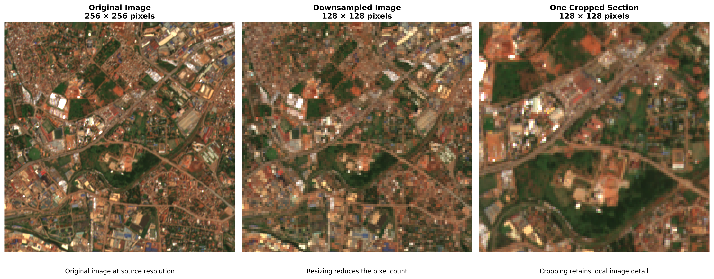
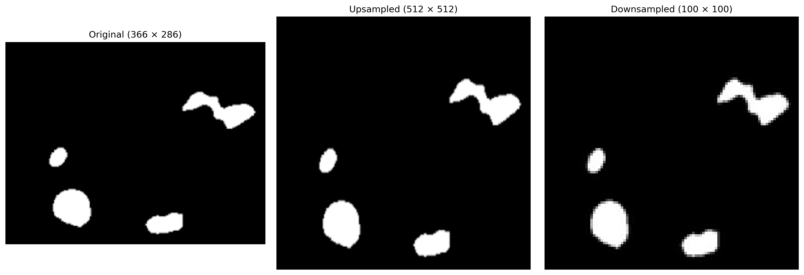
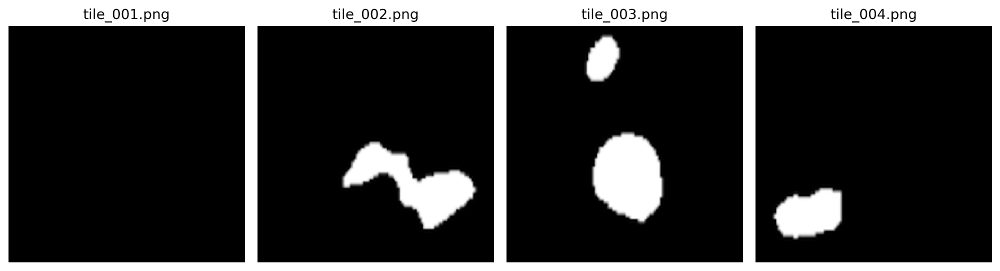

Image processing is a common task in machine learning, spanning applications from medical image analysis to Earth exploration through satellite imagery. However, working with images, especially high-resolution imagery, can be computationally expensive. Even relatively low-resolution images can consume significant resources when analysing large geographical areas, such as mapping the built environment across an entire country or continent.

To make image processing more manageable, we often need to reduce the size of images or divide them into smaller patches before feeding them into a machine learning model. Several techniques can be used to achieve this, depending on the task, the available computational resources, and the level of detail that needs to be preserved.

In this blog post, we will explore some of these techniques, how they work, and when to use them.

### Why Alter Image Shape?

Before exploring the techniques used to resize or divide images, let us first understand why altering image dimensions can be important during model training and inference.

1. Model Input Constraints: Many machine learning models expect images of a specific input size, such as 256 × 256 or 512 × 512 pixels. To ensure compatibility, images may need to be resized or divided into patches that match the model's expected input dimensions. Some models also require consistent input shapes across batches.
2. Accuracy vs. Spatial Detail: Image size can influence how much spatial detail a model can capture. Larger images generally preserve finer details, which can be important for tasks such as building detection and semantic segmentation. Resizing images to smaller dimensions may cause the loss of important features, potentially affecting model performance. The challenge is to balance computational efficiency with the level of detail required for the task.
3. Memory and Computational Constraints: High-resolution images require more memory and computational power to process. Resizing images or splitting them into smaller patches can help them fit within available hardware resources. Smaller inputs may also reduce training and inference time, making it possible to process larger datasets more efficiently.

The goal is to find an appropriate image size that meets the model's requirements while preserving the information needed to solve the task effectively.

### Techniques for Processing Image Size

Resizing and tiling are two common techniques used to prepare images for machine learning. Resizing changes the dimensions of an entire image, either increasing or decreasing its size, while tiling divides an image into smaller sections or patches. Each technique has its advantages and limitations, depending on the task, the image resolution, and the available computational resources. Let us explore them in detail.

#### Resizing

Resizing involves changing the pixel dimensions of an image. This can be done through two operations: upsampling, which increases the image dimensions, and downsampling, which reduces them.

These operations typically use interpolation techniques to estimate pixel values when the image dimensions change. The choice of interpolation method can affect the resulting image quality and the amount of detail preserved.

It is important to note that upsampling increases the number of pixels, but it does not necessarily increase the actual detail or information contained in an image. Similarly, downsampling can remove important details, particularly when small objects or fine boundaries are involved.

There are two common ways to resize an image:

- Target dimensions: Specify the desired width and height, such as 500 × 500 or 64 × 64 pixels.
- Scaling factor: Multiply the original width and height by a specified factor. A factor greater than 1 enlarges the image, a factor between 0 and 1 reduces it, and a factor of 1 leaves its dimensions unchanged.
When to use resizing

Resizing is particularly useful when:

- The image contains a large, dominant object that occupies most of the frame.
- The task relies primarily on global context, overall shape, or colour.
- Working on image classification tasks where fine-grained spatial details are not essential.
- A model requires fixed input dimensions.
- Computational resources are limited, and reducing the input size is necessary.

Advantages

- Fast and computationally efficient: Resizing an entire image is generally straightforward and inexpensive.
- Preserves global context: The overall scene remains visible, allowing the model to learn relationships across the image.
- Standardises input dimensions: Images can be prepared to match a model's expected input size.
- Reduces memory requirements: Downsampling reduces the number of pixels the model needs to process.

Limitations

- Loss of spatial detail: Downsampling can remove fine features, making small objects and narrow boundaries difficult to distinguish.
- Small objects may disappear: Features such as individual buildings, roads, or other structures can become indistinguishable from their surroundings.
- Potential distortion: Changing the width and height independently can alter the proportions of objects in an image.
- Limited benefit from upsampling: Enlarging an image does not recover information that was absent from the original.
For applications such as satellite image analysis, these limitations are particularly important.

Resizing an entire satellite scene may preserve the general geographical context while removing the fine details needed to identify individual buildings or other small structures. In such cases, tiling may be a better alternative, as it allows the model to process smaller regions while retaining more of the original spatial detail.

### Tiling

Tiling, also known as the sliding window approach, involves dividing a large image into smaller patches or tiles that can be processed independently. Unlike resizing, tiling allows us to preserve the original image resolution while working with smaller inputs.

The process involves moving a window of a specified width and height across the image, extracting a patch at each position. These patches can then be used individually during model training and inference. When necessary, predictions from the individual tiles can be combined to reconstruct the output for the original image.
Tiling is particularly useful when:

- The original image contains small, distinct objects that may disappear when resized.
- Fine textures, spatial details, and object boundaries are important.
- Working with high-resolution satellite imagery, medical images, or aerial photographs.
- The entire image is too large to fit into the available computational memory.
- The task involves detecting or segmenting small objects across large geographical areas.

Advantages

- Preserves original spatial resolution: Tiles retain the pixel detail of the original image, provided no resizing is applied during extraction.
- Increases the number of training samples: A single large image can produce multiple smaller training patches.
- Reduces memory requirements per input: Smaller patches are easier to process than the full-resolution image.
- Improves visibility of small objects: Features that would otherwise be lost during downsampling remain more distinguishable.

Limitations

- Background-only tiles: Some tiles may contain no relevant objects, resulting in unnecessary training samples and storage requirements.
- Objects may be split across tile boundaries: An object near the edge of one tile may be cut off, making it harder for the model to learn its complete shape.
- Loss of global context: Individual tiles show only a portion of the original scene, potentially limiting the model's understanding of the broader surroundings.
- Additional preprocessing and reconstruction: Predictions from individual tiles may need to be combined carefully, especially when tiles overlap.

To get the most out of tiling, consider the following strategies.

1. Use overlapping tiles

Instead of dividing an image into perfectly adjacent, non-overlapping grids, allow neighbouring tiles to share some pixels. This overlap increases the likelihood that objects near tile boundaries will appear more completely in at least one tile.

For example, a 512 × 512 window can move across an image in steps of 384 pixels, creating a 128-pixel overlap between neighbouring tiles. The appropriate overlap depends on the size of the objects being detected and the computational resources available.

1. Filter out empty tiles

Some tiles may contain only background pixels and no examples of the target objects. Depending on the task, these tiles can be discarded or sampled selectively to reduce storage requirements and training time.

However, it is important not to remove all background-only tiles. A model still needs negative examples to learn where the target objects are absent. The goal is to maintain a reasonable balance between tiles containing target objects and those containing only background.

1. Handle image boundaries carefully

When the sliding window reaches the edge of an image, the remaining region may be smaller than the specified tile size. You can handle this by padding the image, adjusting the final window position, or using another consistent boundary-handling strategy.

1. Reconstruct predictions correctly

During inference, overlapping tiles may produce multiple predictions for the same pixels. These predictions should be combined consistently, for example by averaging overlapping probability maps before applying a classification threshold. This helps reduce visible seams and inconsistencies in the final output.

Tiling is a powerful technique when preserving fine spatial detail is essential. For satellite imagery applications such as building detection or semantic segmentation, it allows models to analyse large geographical areas without sacrificing the resolution needed to identify smaller structures.

### Conclusion

Choosing the right image preprocessing technique is an important step in building efficient and accurate machine learning models. Resizing and tiling offer different advantages, and the best approach depends on the task, the level of spatial detail required, and the available computational resources.

If global context is important, resizing may be the better choice, as it preserves the overall scene while reducing computational demands. However, when fine details and small objects matter, tiling is often more suitable because it preserves the original spatial resolution.

Ultimately, there is no one-size-fits-all solution. Understanding your data, your model's requirements, and the trade-offs between image detail and computational efficiency will help you choose the most appropriate technique for your application.